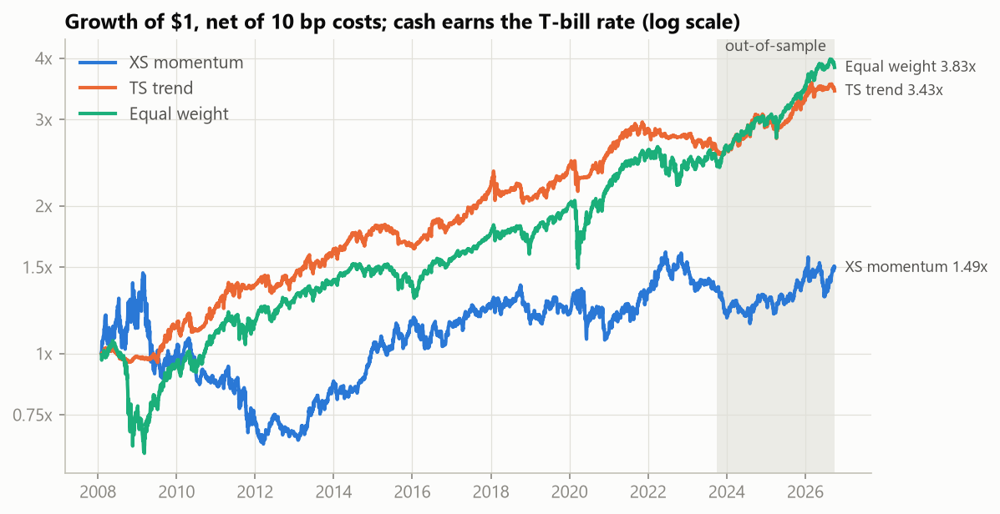
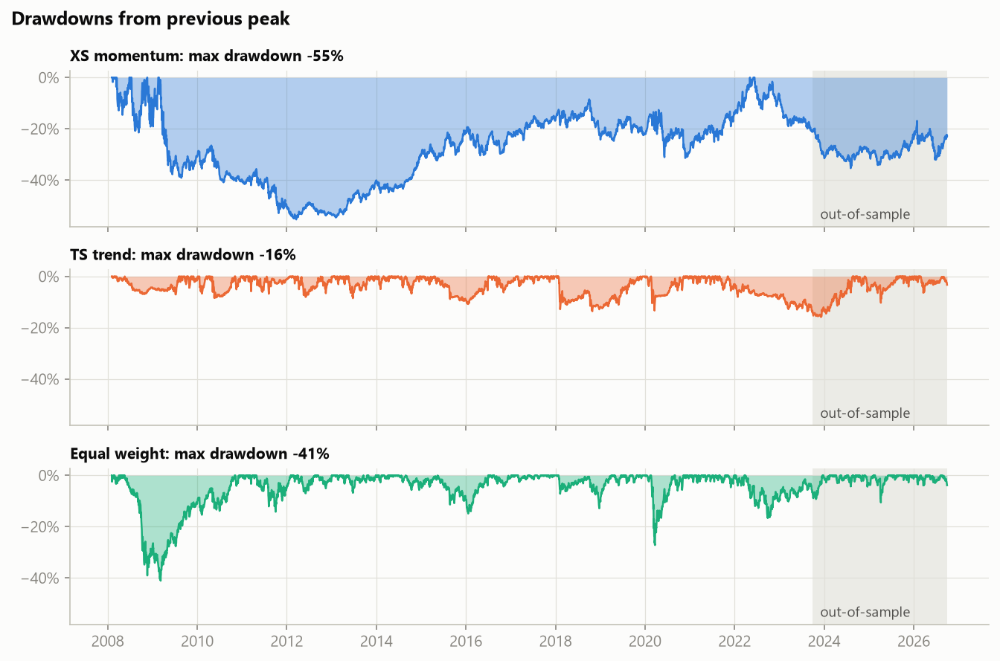
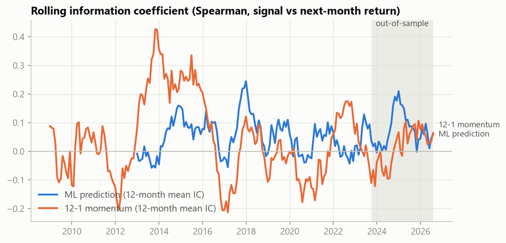
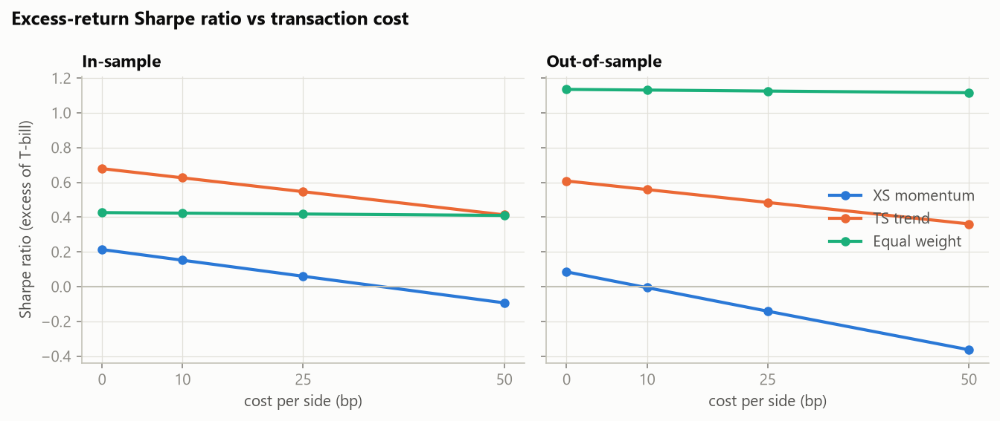
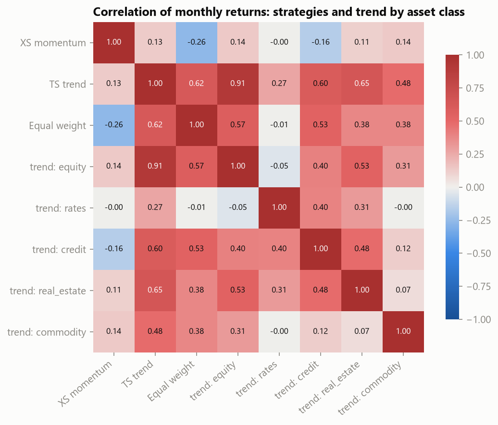

<!-- GENERATED by analysis/findings.py from results/. Do not edit by hand. -->
# Cross-Asset Momentum and Trend Signals: Research and Backtest

**Question.** Do simple momentum and trend signals, applied across 24 liquid ETFs spanning
equities, Treasuries, credit, TIPS, REITs and commodities, predict returns well enough to survive
realistic costs, and do they hold up on 3 years of data that was never used to make any choice?

(live demo)[https://cross-asset-momentum.onrender.com]
## Key results

The last 3 years (2023-10-01 to 2026-09-30) are a true hold-out. All parameters were chosen on
earlier data only. Costs are 10 bp per side. Positions trade at the close one session after the signal.

- Cross-sectional momentum **showed no statistically significant predictive power out of sample**: 12-1 momentum IC 0.023 with t-stat 0.37 (threshold 2). The strategy's OOS Sharpe was -0.01 (in-sample 0.15), and in-sample it suffered a -55% drawdown.
- Time-series trend had an OOS Sharpe of 0.56 (in-sample 0.63), below the equal-weight benchmark's 1.13 out of sample (in-sample: 0.63 vs 0.42). In-sample max drawdown was -14% vs the benchmark's -41%, so its clearest benefit is drawdown control. Volatility scaling runs it 1.24x net long in-sample and 1.45x out of sample. With that leverage financed at the T-bill rate and Sharpe measured over it, its OOS Sharpe is 0.56, versus 1.22 under the old 0%-cash convention, which let it borrow for free.
- The ML model **did not significantly beat** simple 12-1 momentum. On identical months, its mean IC was 0.081 vs 0.023 out of sample (paired difference t = 0.91, p = 0.371, 35 months) and 0.050 vs 0.065 before the hold-out (t = -0.41, p = 0.682, 139 months). A higher point estimate on a few dozen noisy monthly ICs is not evidence of a better signal.

Sharpe ratios are on returns in excess of the 3-month T-bill. Idle cash earns the T-bill rate, and leverage
is financed at it. The previous convention (cash earns 0%, Sharpe on raw returns) is shown alongside for comparison.

| Strategy                         |   IS Sharpe (0% rf) |   IS Sharpe (excess) |   OOS Sharpe (0% rf) |   OOS Sharpe (excess) | OOS ann. return   | OOS ann. vol   | OOS max DD   |
|:---------------------------------|--------------------:|---------------------:|---------------------:|----------------------:|:------------------|:---------------|:-------------|
| XS momentum (L/S terciles)       |                0.15 |                 0.15 |                -0.01 |                 -0.01 | 3.5%              | 13.2%          | -17%         |
| TS trend (vol-scaled)            |                0.73 |                 0.63 |                 1.22 |                  0.56 | 9.8%              | 9.8%           | -11%         |
| Equal weight, monthly rebalanced |                0.48 |                 0.42 |                 1.59 |                  1.13 | 16.0%             | 9.7%           | -11%         |
| Equal weight, buy and hold       |                0.51 |                 0.45 |                 1.38 |                  1.02 | 17.8%             | 12.5%          | -14%         |
| ML rank L/S (walk-forward)       |                0.15 |                 0.15 |                 0.33 |                  0.33 | 7.8%              | 11.2%          | -11%         |



## Data

| Source | Series | Notes |
|---|---|---|
| yfinance | 24 ETFs, daily `Adj Close` and volume | `Adj Close` is split- **and** dividend-adjusted; every return uses it (enforced by `tests/test_return_basis.py`) |
| FRED (pandas-datareader, no key) | DGS10, DGS2, T10Y2Y, DTB3 (3M T-bill: risk-free rate, converted from discount to bond-equivalent yield) | lagged 1 session for publication; forward-filled at most 5 sessions |

Window: 2007-01-03 to 2026-09-30. First signal 2008-01-31 (after the longest look-back warms up).

### Pipeline

```
yfinance / FRED --(retry + backoff)--> data/raw/*.parquet + manifest   (immutable cache, resumable)
   --> DuckDB raw.*            as received
   --> DuckDB clean.*          ticker x NYSE-session grid, one boolean column per DQ rule
   --> analysis.panel (VIEW)   clean minus hard-rule rows, joined to lagged macro
   --> features --> signals --> backtest / IC / ML --> results/ --> README, charts, dashboard
```

### Data quality

Rows are flagged, never deleted. Hard rules exclude a row from the panel; soft rules keep it and tag it.
Prices are never forward-filled.

- 55 of 55 row-count reconciliation checks pass (cache → raw → clean → analysis view → parquet, also per ticker).
- Clean rows: 119,141; analysis-panel rows: 119,141.
- Universe exceptions: HYG starts 2007-04-11 (included_late_start).

| Rule                  | Type                 |   Rows flagged |
|:----------------------|:---------------------|---------------:|
| duplicate_date        | hard (excluded)      |              0 |
| off_calendar          | hard (excluded)      |              0 |
| missing_price         | hard (excluded)      |              0 |
| nonpositive_price     | hard (excluded)      |              0 |
| missing_session       | soft (kept, flagged) |              0 |
| stale_price           | soft (kept, flagged) |             15 |
| zero_volume           | soft (kept, flagged) |              0 |
| extreme_return        | soft (kept, flagged) |            247 |
| return_spans_gap      | soft (kept, flagged) |              0 |
| partial_coverage_date | soft (kept, flagged) |              0 |

Full detail, including every flagged extreme return: [`reports/data_quality.md`](reports/data_quality.md).

## Signals (all known at the close of the signal date)

| Feature | Definition |
|---|---|
| Momentum 12-1 | return from t-12m to t-1m (21 sessions = 1 month), skipping the latest month |
| Short-term reversal | minus the trailing 1-month return |
| Trend | price / 200-day moving average - 1 |
| Realized vol | 60-day std of daily returns, annualized; used to scale trend positions |
| Curve regime | inverted if 10Y-2Y < 0 (publication-lagged) |

**Timing.** Signals are computed at the close of the last session of each month. Trades execute at the close
of the next session, so a new position first earns the return 2 sessions after the signal. The
no-lookahead tests (`tests/test_features.py`) replace all data after a cutoff with noise and assert that every
feature, every target weight and every daily P&L value at or before the cutoff is unchanged. A deliberately
leaky feature is included to prove the check can fail.

**Strategies.**
(a) *Cross-sectional momentum*: long the top third and short the bottom third by momentum, equal weight
(the long and short books are each equal to capital). Selected look-back: 9-1 months.
(b) *Time-series trend*: long above the moving average, flat below, each asset scaled to
20% vol / N (per-asset leverage cap 5x, gross cap 2x). Selected MA: 150 days.
(c) *Benchmarks*: equal weight, monthly rebalanced, and equal-weight buy-and-hold.
(d) *ML*: gradient boosting, long/short terciles of predicted rank.

## Results: in-sample vs out-of-sample (net of 10 bp)

| Strategy                         | Period                             | Ann. return   | Ann. vol   |   Sharpe (excess) |   Sharpe (0% rf, old) | Max DD   |   Turnover/yr | Hit rate (months)   |
|:---------------------------------|:-----------------------------------|:--------------|:-----------|------------------:|----------------------:|:---------|--------------:|:--------------------|
| XS momentum (L/S terciles)       | in-sample (2008-02 to 2023-09)     | 1.9%          | 19.2%      |              0.15 |                  0.15 | -55%     |          11.8 | 55%                 |
| XS momentum (L/S terciles)       | out-of-sample (2023-10 to 2026-09) | 3.5%          | 13.2%      |             -0.01 |                 -0.01 | -17%     |          12   | 61%                 |
| TS trend (vol-scaled)            | in-sample (2008-02 to 2023-09)     | 6.3%          | 9.0%       |              0.63 |                  0.73 | -14%     |           4.8 | 64%                 |
| TS trend (vol-scaled)            | out-of-sample (2023-10 to 2026-09) | 9.8%          | 9.8%       |              0.56 |                  1.22 | -11%     |           4.8 | 72%                 |
| Equal weight, monthly rebalanced | in-sample (2008-02 to 2023-09)     | 5.9%          | 13.9%      |              0.42 |                  0.48 | -41%     |           0.5 | 64%                 |
| Equal weight, monthly rebalanced | out-of-sample (2023-10 to 2026-09) | 16.0%         | 9.7%       |              1.13 |                  1.59 | -11%     |           0.4 | 72%                 |
| Equal weight, buy and hold       | in-sample (2008-02 to 2023-09)     | 6.2%          | 13.7%      |              0.45 |                  0.51 | -39%     |           0.1 | 64%                 |
| Equal weight, buy and hold       | out-of-sample (2023-10 to 2026-09) | 17.8%         | 12.5%      |              1.02 |                  1.38 | -14%     |           0   | 67%                 |
| ML rank L/S (walk-forward)       | in-sample (2012-02 to 2023-09)     | 2.1%          | 11.9%      |              0.15 |                  0.15 | -25%     |          22.4 | 50%                 |
| ML rank L/S (walk-forward)       | out-of-sample (2023-10 to 2026-09) | 7.8%          | 11.2%      |              0.33 |                  0.33 | -11%     |          20.1 | 67%                 |

Sharpe (excess) is on returns over the T-bill; Sharpe (0% rf, old) is the previous convention. Annual return
includes interest on idle cash and the cost of financing leverage. Max drawdown is measured within each period, so a
drawdown that spans the boundary is split; the chart below shows the continuous series. The ML strategy starts in 2012, after its first
walk-forward training window.



### Information coefficient (Spearman, signal vs next-month return)

The t-stat is mean / (std / sqrt(months)). The one signal month whose return window straddles the hold-out
boundary is excluded from both periods.

| Signal             |   IS mean IC |   IS std |   IS t-stat |   IS months |   OOS mean IC |   OOS std |   OOS t-stat |   OOS months |
|:-------------------|-------------:|---------:|------------:|------------:|--------------:|----------:|-------------:|-------------:|
| mom_12_1           |        0.042 |    0.433 |        1.34 |         187 |         0.023 |     0.368 |         0.37 |           35 |
| mom_selected (9-1) |        0.045 |    0.424 |        1.44 |         187 |         0.005 |     0.366 |         0.08 |           35 |
| reversal (-ret_1m) |        0.007 |    0.408 |        0.25 |         187 |        -0.073 |     0.317 |        -1.36 |           35 |
| trend_200          |        0.031 |    0.415 |        1.03 |         187 |        -0.022 |     0.327 |        -0.4  |           35 |
| ml_pred            |        0.05  |    0.285 |        2.07 |         139 |         0.081 |     0.277 |         1.72 |           35 |



### ML extension

`HistGradientBoostingRegressor` predicts each asset's next-month cross-sectional return rank from ranked
momentum, 1-month return, trend, volatility and the curve flag. It is retrained every January on an expanding
window, using only rows whose label had fully realized by the fit date. Hyperparameters were fixed in advance
and never tuned. Retraining continues through the hold-out, as it would in live trading; no choice was made
after seeing hold-out results.

The ML model **did not significantly beat** simple 12-1 momentum. On identical months, its mean IC was 0.081 vs 0.023 out of sample (paired difference t = 0.91, p = 0.371, 35 months) and 0.050 vs 0.065 before the hold-out (t = -0.41, p = 0.682, 139 months). A higher point estimate on a few dozen noisy monthly ICs is not evidence of a better signal.

| Period        |   Months |   ML mean IC |   12-1 momentum mean IC |   Difference |   Paired t |   p-value |
|:--------------|---------:|-------------:|------------------------:|-------------:|-----------:|----------:|
| in-sample     |      139 |        0.05  |                   0.065 |       -0.015 |      -0.41 |     0.682 |
| out-of-sample |       35 |        0.081 |                   0.023 |        0.057 |       0.91 |     0.371 |

Note: momentum's OOS IC t-stat (0.3719) and this p-value (0.3714) round to the same two decimals by coincidence. The first tests whether momentum's mean IC differs from zero (one-sample t on the IC series). The second tests whether ML's IC differs from momentum's on the same months (paired t-test on the difference, t = 0.9059). `tests/test_research.py` recomputes both from the monthly ICs.

## Robustness

### Parameter sensitivity (all grid points shown; selection used in-sample Sharpe only)

Cross-sectional momentum:

| Parameters   | Selected (IS only)   | Spec default   |   IS Sharpe | IS ann. return   |   OOS Sharpe | OOS ann. return   |
|:-------------|:---------------------|:---------------|------------:|:-----------------|-------------:|:------------------|
| 3-1 months   |                      |                |       -0.05 | -1.8%            |        -1.15 | -12.7%            |
| 6-1 months   |                      |                |        0.13 | 1.4%             |        -1.01 | -10.0%            |
| 9-1 months   | **yes**              |                |        0.15 | 1.9%             |        -0.01 | 3.5%              |
| 12-1 months  |                      | yes            |        0.15 | 1.9%             |         0.19 | 6.3%              |
| 12-0 months  |                      |                |        0.08 | 0.3%             |         0.54 | 11.6%             |

Time-series trend:

| Parameters           | Selected (IS only)   | Spec default   |   IS Sharpe | IS ann. return   |   OOS Sharpe | OOS ann. return   |
|:---------------------|:---------------------|:---------------|------------:|:-----------------|-------------:|:------------------|
| MA 50d, flat below   |                      |                |        0.26 | 2.7%             |         0.48 | 8.5%              |
| MA 50d, short below  |                      |                |       -0.24 | -2.1%            |        -0.34 | 1.0%              |
| MA 100d, flat below  |                      |                |        0.5  | 5.0%             |         0.42 | 8.2%              |
| MA 100d, short below |                      |                |        0.2  | 2.5%             |        -0.37 | 0.5%              |
| MA 150d, flat below  | **yes**              |                |        0.63 | 6.3%             |         0.56 | 9.8%              |
| MA 150d, short below |                      |                |        0.44 | 5.0%             |        -0.05 | 3.6%              |
| MA 200d, flat below  |                      | yes            |        0.62 | 6.4%             |         0.64 | 10.9%             |
| MA 200d, short below |                      | yes            |        0.48 | 5.4%             |         0.18 | 5.8%              |
| MA 250d, flat below  |                      |                |        0.58 | 6.0%             |         0.66 | 11.5%             |
| MA 250d, short below |                      |                |        0.43 | 4.7%             |         0.31 | 7.2%              |

### Transaction costs

| Strategy                         | Period        |   Sharpe @ 0 bp |   Sharpe @ 10 bp |   Sharpe @ 25 bp |   Sharpe @ 50 bp |   Turnover/yr |
|:---------------------------------|:--------------|----------------:|-----------------:|-----------------:|-----------------:|--------------:|
| XS momentum (L/S terciles)       | in-sample     |            0.21 |             0.15 |             0.06 |            -0.09 |          11.8 |
| XS momentum (L/S terciles)       | out-of-sample |            0.09 |            -0.01 |            -0.14 |            -0.36 |          12   |
| TS trend (vol-scaled)            | in-sample     |            0.68 |             0.63 |             0.55 |             0.41 |           4.8 |
| TS trend (vol-scaled)            | out-of-sample |            0.61 |             0.56 |             0.48 |             0.36 |           4.8 |
| Equal weight, monthly rebalanced | in-sample     |            0.43 |             0.42 |             0.42 |             0.41 |           0.5 |
| Equal weight, monthly rebalanced | out-of-sample |            1.13 |             1.13 |             1.13 |             1.12 |           0.4 |

At 50 bp, XS momentum's in-sample Sharpe is -0.09; its turnover makes it the
most cost-sensitive strategy.



### Stress windows (total return, max drawdown; all inside the in-sample period)

| Window                                     | XS momentum (L/S terciles)   | TS trend (vol-scaled)   | Equal weight, monthly rebalanced   |
|:-------------------------------------------|:-----------------------------|:------------------------|:-----------------------------------|
| 2008 crisis (2008-09-01 to 2009-03-31)     | 14.9% (DD -22%)              | 0.5% (DD -2%)           | -28.7% (DD -36%)                   |
| 2020 COVID (2020-02-19 to 2020-04-30)      | -3.0% (DD -10%)              | -7.4% (DD -13%)         | -14.4% (DD -27%)                   |
| 2022 rate hikes (2022-01-01 to 2022-12-31) | 15.1% (DD -12%)              | -4.0% (DD -5%)          | -7.8% (DD -17%)                    |

### Yield curve inverted vs not (regime known at the start of each month)

| Strategy                         | Curve        |   Months |   of which OOS | Mean monthly excess return   |   Ann. Sharpe (excess) | Hit rate   |
|:---------------------------------|:-------------|---------:|---------------:|:-----------------------------|-----------------------:|:-----------|
| XS momentum (L/S terciles)       | inverted     |       26 |             11 | -1.14%                       |                  -1.38 | 42%        |
| XS momentum (L/S terciles)       | not inverted |      198 |             25 | 0.31%                        |                   0.26 | 57%        |
| TS trend (vol-scaled)            | inverted     |       26 |             11 | -0.08%                       |                  -0.11 | 58%        |
| TS trend (vol-scaled)            | not inverted |      198 |             25 | 0.54%                        |                   0.76 | 63%        |
| Equal weight, monthly rebalanced | inverted     |       26 |             11 | 0.38%                        |                   0.37 | 62%        |
| Equal weight, monthly rebalanced | not inverted |      198 |             25 | 0.56%                        |                   0.57 | 65%        |

Only 26 months had an inverted curve, so these differences are not statistically meaningful.

### Correlation across strategies and asset-class trend sleeves



## Limitations

- **ETFs are not futures.** USO and DBC hold rolling futures and carry roll costs; GLD and SLV hold metal;
  bond ETFs differ from bond futures. Real trend-following CTAs trade futures with far more markets.
- **Small universe.** Only 24 assets, 13 of them equity funds. The trend portfolio's monthly correlation with its
  equity sleeve alone is 0.91, so "cross-asset" diversification is weaker than the asset list suggests.
  Cross-sectional ranks over 24 names are noisy.
- **The period may be unusual.** Falling rates for most of the sample, then the 2022 shock. The hold-out is
  only 36 months, during a strong bull market.
- **Transaction costs are estimated**, as a flat per-side rate. There is no bid-ask modelling, market impact or
  borrow cost for shorts.
- **Financing is idealized.** Cash and leverage both earn or pay exactly the T-bill rate. Real brokers charge
  a spread over it, and shorting ETFs carries borrow fees, both of which would lower the levered and
  long/short results.
- **Selection bias.** The ETF list was chosen with hindsight; all of these funds survived.
- **Single, unofficial data vendor** (yfinance), with no second source to cross-check prices.
- **Past performance does not predict future results.**

## Reproduce

```bash
python -m venv .venv && .venv/Scripts/activate   # macOS/Linux: source .venv/bin/activate
pip install -r requirements.txt && pip install -e .
python -m xasset.pipeline          # download (cached), DQ, curated panel
python -m xasset.research          # signals, backtests, robustness, ML -> results/
python analysis/charts.py          # figures
python analysis/findings.py        # regenerate this README
pytest                             # no-lookahead, DQ, backtest math, reconciliation, README freshness
streamlit run app/app.py           # dashboard (reads results/ only)
```

## Layout

```
src/xasset/    pipeline (ingest, quality, curate, warehouse, report), features, backtest, ml, research
analysis/      charts.py, findings.py (this README)
app/           Streamlit dashboard (pre-aggregated data only; render.yaml for Render)
tests/         pytest suite
results/       small generated outputs and figures (committed)
reports/       data_quality.md
DECISIONS.md   plain-language log of every methodological choice
data/          raw cache, DuckDB, curated panel (git-ignored, regenerated)
```
