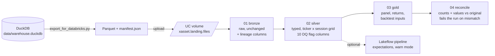

# Databricks port: bronze / silver / gold with reconciliation

This folder rebuilds the project's data pipeline (`src/xasset/`: DuckDB, pandas) as a
Databricks lakehouse pipeline on **Databricks Free Edition**:

- Delta tables in Unity Catalog, in bronze → silver → gold layers.
- The same 10 data-quality rules as flag columns. Rows are flagged, never deleted.
- A reconciliation notebook that checks every handoff and compares the output
  row by row with the original DuckDB pipeline.
- A scheduled Lakeflow Job that runs it all.

The existing pipeline, tests, and dashboard are unchanged. Everything new lives in `databricks/`.



## Layers

| Layer | Tables (`<catalog>.<schema>.<table>`) | What it holds |
|---|---|---|
| landing | volume `landing.files` | The exported Parquet files and `manifest.json` |
| bronze | `prices`, `macro`, `ref_nyse_sessions`, `ref_universe` | Files loaded **as-is**, plus `_source_file`, `_source_file_modified`, `_ingested_at`, `_feed_exported_at` |
| silver | `prices`, `macro`, `universe`, `calendar_coverage`, `data_quality_summary`, `rule_counts_by_ticker`, `dq_rule_catalog` | Typed rows on a full ticker × NYSE-session grid (a missing day is an explicit row with NULL prices), with one boolean column per rule. Nothing is deleted. |
| gold | `macro_daily`, `panel`, `daily_returns`, `risk_free_daily`, `signal_dates`, `features` | `panel` = silver minus hard-rule rows, joined to lagged macro (the original `analysis.panel`), plus the inputs the backtest reads |
| ops | `reconciliation_runs`, `time_travel_demo` | Every reconciliation check of every run (appended), plus the time-travel demo table |

**Why three layers.** Bronze is the replayable record of what the vendor sent, so any
later step can be rebuilt without re-downloading. Silver is where rules are applied and
every decision is visible as a column. Gold is shaped for consumers: the backtest
reads it and never sees a bad row. Each boundary is a place to count rows and check
that nothing was lost or invented.

## The 10 data-quality rules (ported, not changed)

"Usable" = a raw row, the first copy of its (ticker, date), and not caught by hard rules 2–4.
Hard rules remove rows from `gold.panel`. Soft rules keep the row and list the
rule in `dq_soft_flags`. Thresholds live in `pipeline_lib.py`. The bronze notebook
fails if they differ from the snapshot of `src/xasset/config.py` in the manifest.

| # | Rule | Type | Checks | Runs in Spark as |
|---|---|---|---|---|
| 1 | `flag_duplicate_date` | hard* | (ticker, date) appears more than once. All copies flagged; only `dup_rank > 1` excluded | window count over (ticker, date) |
| 2 | `flag_off_calendar` | hard | Date is not an NYSE session | left join to session list |
| 3 | `flag_missing_price` | hard | NULL/NaN `adj_close` or `close` | SQL predicate (`isnan` too: Spark NaN ≠ NULL) |
| 4 | `flag_nonpositive_price` | hard | `adj_close <= 0` or `close <= 0` | SQL predicate |
| 5 | `flag_missing_session` | soft | Session in the ticker's active range with no raw row; inserted with NULL prices | cross join + anti join |
| 6 | `flag_stale_price` | soft | ≥ 5 consecutive usable rows with the same `close` | `applyInPandas`, per ticker |
| 7 | `flag_zero_volume` | soft | `volume == 0` | `applyInPandas`, per ticker |
| 8 | `flag_extreme_return` | soft | \|return\| > 15% or \|robust z\| > 8 (trailing 252-row median / 1.4826·MAD, min 60) | `applyInPandas`, per ticker |
| 9 | `flag_return_spans_gap` | soft | Previous usable row is not the preceding session | `applyInPandas`, per ticker |
| 10 | `flag_partial_coverage_date` | soft | Some active ticker has no usable price that session | `groupBy(date)` |

The four time-series rules run as pandas code inside Spark (`groupBy("ticker").applyInPandas`).
That keeps them line-for-line comparable with `quality.py`, and
`tests/test_parity_with_original.py` asserts they match the original row for row.
Spark still parallelizes the work across tickers. Set-based rules (keys, joins,
per-date coverage) are native Spark SQL.

**Dedupe** uses the original keys: `dup_rank` = row number within (ticker, date) by `raw_row_id`.
Silver keeps every copy, flagged. Gold drops `dup_rank > 1`, exactly like the original view.

## Reconciliation (`04_reconcile.py`)

Every check is a row with `expected`, `actual`, and `ok`. All of them are appended to
`ops.reconciliation_runs` with a run id. If any check fails, the notebook raises *after*
writing them, so the Job fails and the evidence is saved.

| Stage | Checks |
|---|---|
| feed (in 01) | Manifest config = `pipeline_lib` config; every file present; SHA-256 matches, so a partial or corrupted upload stops before any table is written |
| manifest → bronze | Rows per table, per ticker, and per FRED series |
| bronze → silver | `silver.prices` = included raw rows + inserted missing sessions (total and per ticker); macro rows unchanged; summary covers 10 rules |
| silver → gold | `gold.panel` = silver − hard-rule exclusions (total and per ticker); no duplicate (date, ticker); one macro row per session; `daily_returns` = `panel` |
| vs original counts | Rows vs `clean.prices`, `analysis.panel`, `clean.macro_daily`; each rule's total; every (ticker, rule) cell of `meta.rule_counts` |
| vs original values | **Every** `gold.panel` row full-outer-joined to the original `analysis.panel` on (date, ticker). Rows on only one side must be 0. `daily_return`, `adj_close`, `volume`, and the four macro values must agree within 1e-12 (relative). `asset_class`, `macro_ffilled`, and `dq_soft_flags` must match exactly. A random 20-row sample is shown side by side. |

You asked for a *sample* of returns. The panel is small enough that comparing every row is cheap,
so the check covers all of them, and the sample is shown for eyeballing.

**Delta time travel** (end of 04):
1. `DESCRIBE HISTORY gold.panel`, then a comparison of the last two versions. The feed is a pinned
   snapshot, so a rerun should change 0 rows.
2. On a scratch table, a simulated vendor restatement (Yahoo recomputes `Adj Close` after
   dividends): change one price, query `VERSION AS OF` the previous version to show the diff,
   then `RESTORE`.

## Free Edition: what's used and what isn't

Checked against the Databricks docs in November 2026:
[Free Edition limitations](https://docs.databricks.com/aws/en/getting-started/free-edition-limitations),
[serverless limitations](https://docs.databricks.com/aws/en/compute/serverless/limitations),
[pipeline expectations](https://docs.databricks.com/aws/en/ldp/developer/ldp-python-ref-expectations).

| Feature | Status on Free Edition | What this project does |
|---|---|---|
| Compute | Serverless only, limited size, outbound internet restricted | Everything runs on serverless. No `pip install` is needed: the NYSE calendar is exported as a file instead of installing `exchange_calendars`. |
| Unity Catalog volumes | Available | Landing zone for the uploaded files |
| New catalog | Available on default storage. Some users report the *UI* dialog erroring and SQL working | Create it with SQL (below). Fallback: use the built-in `workspace` catalog and set `catalog=workspace`. |
| Lakeflow Jobs | Max 5 concurrent job tasks per account | 4 sequential tasks |
| Lakeflow (Spark) Declarative Pipelines + expectations | One active pipeline per pipeline type | Optional `pipelines/silver_dq_expectations.py`. Expectations only exist inside pipelines, so the notebooks use flag columns (the source of truth), and the pipeline re-declares the 10 rules as warn-only expectations. |
| Notebook format | Serverless docs say notebooks saved in *source* format may not capture serverless metadata correctly | The notebooks are `.py` source files, as requested. If anything misbehaves, use File → Export → IPython Notebook and run the `.ipynb`. |

## How to run

### On your laptop
```bash
python -m xasset.pipeline                    # builds data/warehouse.duckdb (if not already built)
python databricks/export_for_databricks.py   # -> data/databricks_export/ (7 files)
pytest databricks/tests                      # helper + parity + export tests
```
Running `pytest` without arguments still runs only the original `tests/` folder (see `pytest.ini`).

### In Databricks (Free Edition)
1. **Catalog, schema, volume.** Open **SQL Editor** and run:
   ```sql
   CREATE CATALOG IF NOT EXISTS xasset;
   CREATE SCHEMA IF NOT EXISTS xasset.landing;
   CREATE VOLUME IF NOT EXISTS xasset.landing.files;
   ```
   (The notebooks create `bronze`, `silver`, `gold`, and `ops` themselves.)
2. **Upload.** **Catalog** → `xasset` → `landing` → `files` → **Upload to this volume** → drop all 7 files
   from `data/databricks_export/`.
3. **Code.** **Workspace** → your home folder → **Create → Git folder** → paste the repo URL.
   A public repo needs no credentials. The notebooks need the repo's `src/` folder (gold imports
   `xasset.features`), so clone the whole repo; don't import single files.
4. **Run once by hand.** Open `databricks/01_bronze` → compute picker → **Serverless** → **Run all**.
   Then 02, 03, 04. The `catalog` widget at the top defaults to `xasset`.
5. **Job.** **Jobs & Pipelines → Create → Job**. Add 4 *Notebook* tasks (bronze → silver → gold → reconcile),
   each **Depends on** the previous one, compute **Serverless**. Under **Job parameters**, set `catalog` = `xasset`
   and `job_run_id` = `{{job.run_id}}`. **Add trigger → Scheduled** (for example weekly). Add a
   failure email under notifications. **Run now**.
6. **Optional expectations pipeline.** **Jobs & Pipelines → Create → ETL pipeline**. Add the existing file
   `databricks/pipelines/silver_dq_expectations.py` as source code. Default catalog `xasset`, schema `ops`.
   Configuration `xasset.catalog = xasset`. Run it, open `silver_prices_dq_monitor` → **Data quality** tab.
   To schedule it, add a *Pipeline* task to the Job between silver and gold.

## Results

> From the first manual run of notebooks 01–04 on Databricks Free Edition (serverless), 2026-11-13,
> on the feed exported the same day. Rows marked _TBD_ get filled in after the Job and pipeline runs.

| Item | Value | Source |
|---|---|---|
| Feed checks (01) | 6 Parquet files, SHA-256 and row counts match the manifest | 01 (the notebook stops if any fail) |
| bronze.prices / bronze.macro rows | 119,141 / 20,612 (24 tickers; 4 FRED series × 5,153) | export manifest; 04 "manifest → bronze" checks |
| silver.prices rows | 119,141 (0 missing sessions inserted) | 04 "silver.prices rows = original clean.prices" |
| gold.panel rows | 119,141 (0 rows removed by hard rules) | 04 section E |
| Rows flagged per rule | `extreme_return` 247, `stale_price` 15; the other 8 rules 0 | original `meta.rule_counts`; 04 checks each rule's total and every per-ticker cell match |
| Reconciliation checks passed | **115 of 115** | 04 result |
| Rows compared vs original `analysis.panel`, max \|daily_return diff\| | 119,141 rows, **0.0** | 04 section E |
| Expectation failed-record counts match `rows_flagged` | _TBD_ | pipeline Data quality tab |
| Job run duration (4 tasks) | _TBD_ | Job run page |
| `gold.panel` rows changed between two runs | _TBD_ | 04 time-travel section, after a second run |

The feed is clean: no hard rule fires, so silver and gold have the same row count as the
raw feed. The rules that do fire are both soft (the row stays, flagged), and the Databricks
counts equal the original pipeline's exactly.

## Files

| File | Purpose |
|---|---|
| `export_for_databricks.py` | DuckDB → Parquet + `manifest.json` (row counts, SHA-256, config snapshot). Read-only on the DB. |
| `pipeline_lib.py` | Pure-Python helpers: rule catalog, ported pandas logic, SQL builders, reconciliation helpers. No Spark imports. |
| `01_bronze.py` … `04_reconcile.py` | Databricks notebooks (source format) |
| `pipelines/silver_dq_expectations.py` | Optional Lakeflow pipeline: the 10 rules as warn-only expectations |
| `tests/` | `test_pipeline_lib.py` (pandas only), `test_parity_with_original.py` (vs `src/xasset`; needs `exchange_calendars`, plus `duckdb` for two tests), `test_export.py` (needs `duckdb`) |

## Design notes and trade-offs

- **Full refresh, not incremental.** The feed is a pinned snapshot, so each run overwrites. That makes
  reruns idempotent, and Delta history keeps the old versions. For a daily feed: land each
  file by date, load with Auto Loader or `COPY INTO`, `MERGE` into silver on (ticker, date), and
  recompute flags for a trailing window. The 252-day robust z and the stale-run rule both need history.
- **Gold panel is a table, not a view.** The original uses a view so a rule change needs no rewrite.
  Here the table is cheap to rebuild and gets versioned history for audits.
- **Bad feeds fail early.** A wrong hash, missing file, missing column, or config drift stops bronze
  before any table changes. A count mismatch anywhere fails reconciliation and the Job.
